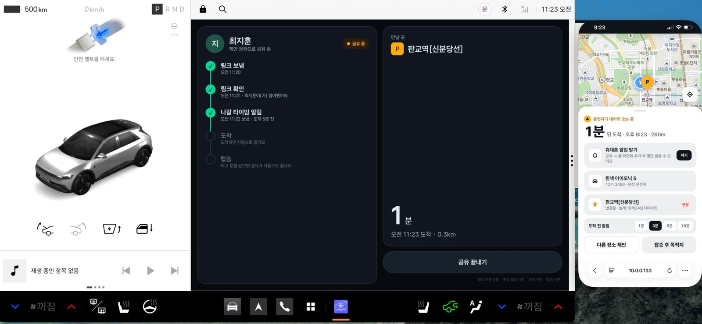
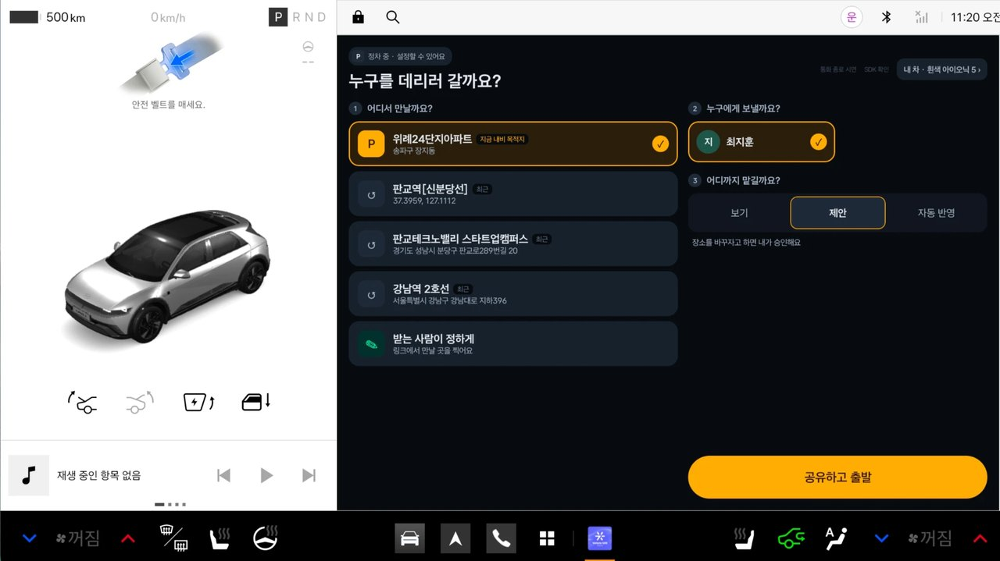
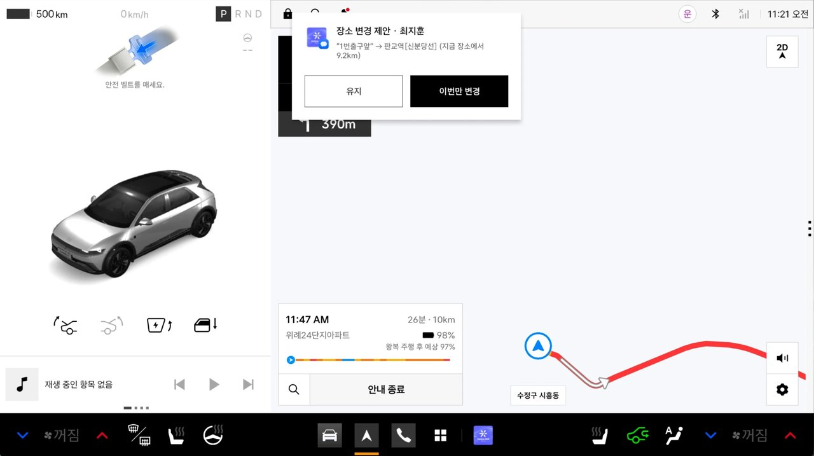
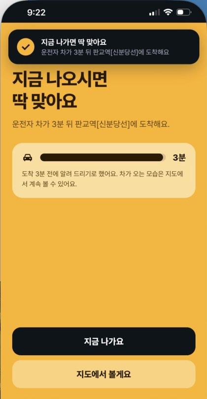
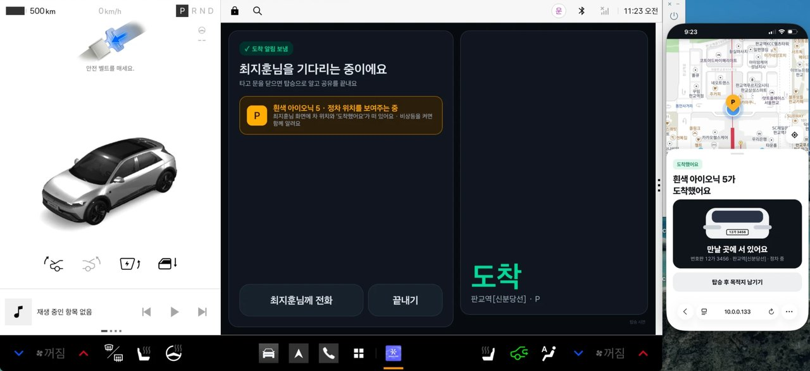
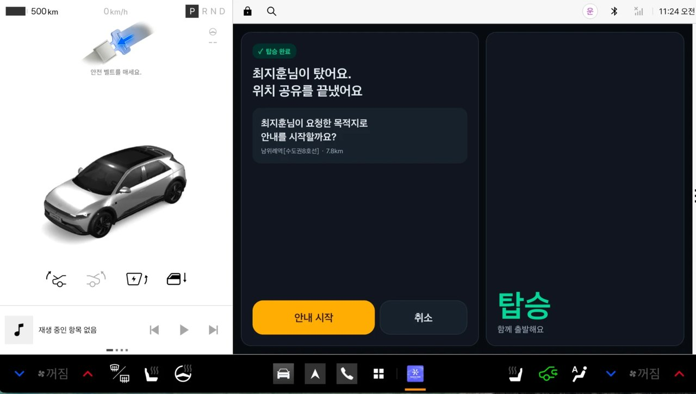

# 나온나 (nowonna)

**차가 알아서 알리고, 받는 사람은 링크 하나로 나와요.**

나온나는 Pleos Connect 차량용 픽업 앱입니다. 운전자가 차량 화면에서 버튼 한 번으로 픽업을 공유하면, 받는 사람은 앱 설치 없이 링크 하나로 차의 실시간 위치와 도착 예정 시간을 봅니다. 만날 장소를 바꾸면 그 변경이 차량 내비게이션에 바로 반영되고, 도착·탑승은 차량 신호(기어·문·계기판)로 자동 감지되어 공유가 끝납니다.

> 현대자동차그룹 차량용 앱 개발 공모전 출품작 · ▶ [시연 영상 보기](TODO_VIDEO_LINK)


<sub>왼쪽: Pleos Connect 차량 화면 (공유 중 · 링크 확인 · 나갈 타이밍 알림 보냄) / 오른쪽: 받는 사람 휴대폰 웹 (앱 설치 없이 링크로 열기)</sub>

**바로 가기:** [픽업 한 번의 흐름](#픽업-한-번의-흐름) · [핵심 설계](#핵심-설계) · [1분 만에 실행해 보기](#가장-빠르게-보기-1분-에뮬레이터-없이) · [코드 구조 (ARCHITECTURE.md)](ARCHITECTURE.md)

---

## 픽업 한 번의 흐름

| ① 운전자: 픽업 시작 | ② 받는 사람이 장소 변경 제안 → 내비 위에서 한 번 탭 승인 |
|---|---|
|  |  |
| 만날 곳 · 보낼 사람 · 권한을 버튼으로만 고르고 [공유하고 출발] | 10초 안에 답하지 않으면 원래 장소를 유지해 운전자가 화면에 매달리지 않아요 |

| ③ 받는 사람: 나갈 타이밍 | ④ 도착 → 차를 바로 알아보기 | ⑤ 탑승 감지 → 공유 끝, 다음 목적지로 |
|---|---|---|
|  |  |  |
| 차 도착 시간과 걸어서 걸리는 시간에 맞춰 "지금 나오시면 딱 맞아요" | 정차하면 자동으로 "도착했어요", 차종·색상·번호판·비상등까지 | 조수석 문이 열렸다 닫히면 위치 공유를 끝내고 기록을 지운 뒤, 받는 사람이 남긴 목적지로 안내할지 물어요 |

---

## 핵심 설계

| 무엇을 | 어떻게 | 코드 |
|---|---|---|
| **차량 특화** | 기어(P)·문(조수석·뒷문)·계기판 경고등(비상등)으로 도착·탑승·비상등을 **운전자 조작 없이** 감지. 장소가 바뀌면 Pleos 내비 경로를 바로 다시 설정 | [`CarSignals.kt`](nowonna/car-app/app/src/main/java/ai/nowonna/car/CarSignals.kt) — Vehicle SDK · NaviHelper SDK |
| **주행 중 안전** | 주행 중엔 큰 버튼 한 번 탭만. 승인 카드는 10초 뒤 자동 유지, 설정은 기어 P일 때만. 차량은 **읽기만** 하고 제어하지 않음 | [`C3Screen.kt`](nowonna/car-app/app/src/main/java/ai/nowonna/car/C3Screen.kt), [`Pickup.kt`](nowonna/car-app/app/src/main/java/ai/nowonna/car/Pickup.kt) |
| **쓰기 쉬움** | 받는 사람은 **앱 설치·가입 없이 링크 하나**. 장소 검색, 나갈 타이밍, 휴대폰 알림 | [`web/index.html`](nowonna/server-lite/web/index.html) |
| **개인정보** | 16자리 무작위 링크 · 2시간 자동 만료 · 탑승하면 위치 즉시 삭제 · 차량 전용 비밀키 · 처리방침 페이지 | [`server.js`](nowonna/server-lite/server.js), [`privacy.html`](nowonna/server-lite/web/privacy.html) |

---

## 한눈에 보기

```
┌──────────────────────┐   위치·남은 시간 (5초)   ┌──────────────┐   실시간 (SSE)   ┌──────────────────┐
│  차량 앱 (Pleos)      │ ───────────────────────▶ │  나온나 서버  │ ───────────────▶ │  받는 사람 웹     │
│  car-app/            │ ◀─────────────────────── │  server-lite/ │ ◀─────────────── │  (링크로 열기)    │
│  Vehicle + NaviHelper│   장소 변경 요청·결과      └──────────────┘   장소 변경·제안   └──────────────────┘
└──────────────────────┘
```

| 폴더 | 내용 |
|---|---|
| [`nowonna/car-app`](nowonna/car-app) | 차량 앱 (Kotlin · Jetpack Compose · Pleos Vehicle SDK 2.3.2 · NaviHelper SDK 3.0.5) |
| [`nowonna/server-lite`](nowonna/server-lite) | 픽업 세션 서버 + 받는 사람 웹 (Node.js, 의존성 없음, TMAP 지도). 주고받는 형식은 [API.md](nowonna/server-lite/API.md) |

---

## 핵심 기능

| 기능 | 어떻게 동작하나요 | 쓰는 차량 기능 |
|---|---|---|
| 한 번 탭 공유 | 내비의 지금 목적지·최근·즐겨찾기 중 하나 + 보낼 사람 + 권한을 고르면 끝 | NaviHelper (목적지·최근·즐겨찾기) |
| 권한 3단계 | **보기**(위치만) · **제안**(운전자 승인) · **자동 반영**(내비에 바로) | NaviHelper `requestRoute` |
| 장소 수정 요청 | 보기 권한이어도 받는 사람이 메시지와 함께 수정 요청 → 운전자 한 번 탭 승인, 10초 무응답이면 원래 장소 유지 | 헤드업 알림 (내비가 앞에 있어도) |
| 통화 후 제안 | 통화가 끝나면 "방금 통화한 분께 픽업 장소를 정하게 할까요?" → 상대가 웹에서 찍은 곳으로 바로 안내 | 차에 연결된 휴대폰의 통화 기록 |
| 도착 감지 | 기어 **P** + 남은 거리 **50m 이내**, 또는 내비 도착 이벤트 | Vehicle (기어) + NaviHelper |
| 탑승 감지 | **조수석·뒷문이 열렸다가 닫힘** → 공유 자동 종료, 링크 만료, 위치 삭제 (운전석 문은 제외) | Vehicle (문) |
| 차 찾기 | 한 번 등록한 차종·색상·번호판과 비상등 상태 → 도착하면 받는 사람 화면에 "비상등 켠 흰색 아이오닉 5가 저예요 · 번호판 12가 3456" (번호판은 시연용 임의 번호) | Vehicle (계기판 경고등) |
| 장소 검색 | 받는 사람이 "강남역 11번 출구"처럼 검색해서 고르면 그 건물 **입구**에 핀이 꽂힘 | TMAP 통합검색 (서버 경유) |
| 나갈 타이밍 | 알림 시점(1·3·5·10분 전, 운전자가 정하고 받는 사람이 웹에서 바꿀 수 있음)과 "걸어서 걸리는 시간 + 30초" 중 더 이른 때에 "지금 나오시면 딱 맞아요" | TMAP 보행자 경로 |
| 휴대폰 알림 | 받는 사람이 [켜기]를 누르면 다른 앱을 보거나 화면이 꺼져도 나갈 타이밍·곧 도착·도착·운전자 답을 알림창으로 (https 필요, 아이폰은 홈 화면에 추가 후) | 웹 푸시 (서버가 직접 구현) |
| 탑승 후 목적지 | 받는 사람이 미리 남긴 목적지를 탑승하면 "안내를 시작할까요?"로 묻고, [안내 시작]이면 바로 내비 화면으로 | NaviHelper `requestRoute` |
| 주행 중 안전 | 설정 화면은 기어가 **P로 확인될 때만** 열림 (기어를 못 읽으면 잠금). 주행 중엔 큰 버튼 한 번 탭만 | Vehicle (기어) |

---

## 차량 앱 화면 (기획서 화면 번호와 같음)

| 화면 | 파일 | 설명 |
|---|---|---|
| C1 픽업 시작 | [`C1Screen.kt`](nowonna/car-app/app/src/main/java/ai/nowonna/car/C1Screen.kt) | 어디서 → 누구에게 → 권한 → [공유하고 출발] |
| C2 공유 중 | [`C2Screen.kt`](nowonna/car-app/app/src/main/java/ai/nowonna/car/C2Screen.kt) | 링크 보냄 → 링크 확인 → 나갈 타이밍 → 도착 → 탑승 진행 단계 |
| C3 변경 요청 | [`C3Screen.kt`](nowonna/car-app/app/src/main/java/ai/nowonna/car/C3Screen.kt) | 받는 사람의 수정 요청·제안 카드 (10초 카운트다운) |
| C4 도착 · C5 탑승 · C6 통화 후 제안 | [`C4C5C6Screens.kt`](nowonna/car-app/app/src/main/java/ai/nowonna/car/C4C5C6Screens.kt) | |
| 내 차 정보 | [`Profile.kt`](nowonna/car-app/app/src/main/java/ai/nowonna/car/Profile.kt) | 이름·차종·색상·번호판·알림 시점 1회 등록 |

## 차량 앱 코드 구조

| 파일 | 맡은 일 |
|---|---|
| [`CarSignals.kt`](nowonna/car-app/app/src/main/java/ai/nowonna/car/CarSignals.kt) | Pleos Vehicle·NaviHelper SDK 연결. 기어·문·경고등·위치·남은 시간을 화면이 바로 읽는 상태로 바꾸고, 도착·탑승을 판단 |
| [`Pickup.kt`](nowonna/car-app/app/src/main/java/ai/nowonna/car/Pickup.kt) | 픽업 1건의 상태와 서버 동기화(5초). 화면과 분리돼 있어 내비가 앞에 있어도 계속 동작 |
| [`PickupService.kt`](nowonna/car-app/app/src/main/java/ai/nowonna/car/PickupService.kt) | 공유 중에만 켜지는 포그라운드 서비스 ("나온나 공유 중" 상시 알림) |
| [`ServerClient.kt`](nowonna/car-app/app/src/main/java/ai/nowonna/car/ServerClient.kt) | 서버 통신 (형식: [API.md](nowonna/server-lite/API.md)) |
| [`Phone.kt`](nowonna/car-app/app/src/main/java/ai/nowonna/car/Phone.kt) | 차에 연결된 휴대폰의 연락처·최근 통화, 통화 종료 감지 |
| [`MainActivity.kt`](nowonna/car-app/app/src/main/java/ai/nowonna/car/MainActivity.kt) | 상태에 따라 C1~C6 화면 전환, 권한 요청 |

---

## 실행해 보기 (실제 차 없이)

### 준비물

| 무엇 | 버전 | 어디에 |
|---|---|---|
| Node.js | 18 이상 (외부 패키지 설치 없음) | 서버 + 받는 사람 웹 |
| JDK | 17 | 차량 앱 빌드 |
| Android Studio + Android SDK | SDK 35, Pleos Connect 에뮬레이터 이미지 | 차량 앱 실행 |
| TMAP 앱키 (선택) | [SK open API](https://openapi.sk.com) 가입 → 앱 만들기 → TMAP API 사용 신청 → 앱키 | 지도·경로·장소 검색. 없으면 개발용 지도로 열려요 |

### 가장 빠르게 보기 (1분, 에뮬레이터 없이)

차량 앱 대신 테스트용 차량(`sim-car.js`)을 써서 받는 사람 웹의 흐름을 끝까지 볼 수 있어요.
```bash
cd nowonna/server-lite
node server.js            # 터미널 1: 서버 (http://localhost:8787)
node sim-car.js           # 터미널 2: 테스트용 차량이 픽업을 시작하고 달려와요
```
터미널 2의 **`이 컴퓨터에서 열기 →`** 줄에 찍힌 `http://localhost:8787/p/…` 주소를 브라우저(휴대폰 크기 보기 추천)로 열면 다음이 차례로 나와요. 앱키가 없으면 차는 직선으로 달려와요.
1. 안내 화면
2. 차가 오는 지도
3. 장소 바꾸기
4. 나갈 타이밍
5. 도착·비상등
6. 탑승

### 1. 서버 + 받는 사람 웹
```bash
cd nowonna/server-lite
node server.js          # http://localhost:8787
```
- **TMAP 지도**: `.env.example`을 `.env`로 복사하고 `TMAP_APP_KEY`에 앱키를 넣으면 TMAP 지도·도로 경로선·장소 검색·핀 주소·도보 시간이 켜져요. 키가 없으면 개발용 지도(OpenStreetMap)로 열리고, 경로선·장소 검색은 빠져요. `.env`는 git에 올라가지 않아요.
- 차량 앱 없이 웹만 볼 때: `node sim-car.js [VIEW|SUGGEST|AUTO] [noplace]` (테스트용 차량이 도로를 따라 달려와요)
- 같은 와이파이의 휴대폰에서 열려면 링크의 `localhost` 대신 이 컴퓨터의 내부 IP를 쓰거나 `.env`의 `PUBLIC_URL`에 넣으세요. [내 위치]·휴대폰 알림은 https 주소에서만 됩니다.

### 2. Pleos Connect 에뮬레이터
1. Android Studio → SDK Manager → SDK Update Sites 에 Pleos 이미지 주소 추가
   `https://nexus-playground.pleos.ai/repository/raw-releases/connect-avd/2.x/crp-arm64-sys-img.xml`
2. API 34 Pleos Connect 이미지 설치 → Device Manager 에서 Automotive AVD 생성 (RAM 4GB, Cold boot)
3. 에뮬레이터가 켜지면 **Pleos 내비 앱을 한 번 열어 주세요.** 내비가 떠 있어야 차량 앱이 현재 위치를 받습니다.

### 3. 차량 앱

**빌드 없이 설치하기:** 저장소 [Releases](../../releases)의 `nowonna-demo.apk`를 받아 바로 설치할 수 있어요. 시연 버튼(모의 주행·변경 요청·도착·탑승)과 시연용 연락처가 들어 있는 시연용 빌드예요.
```bash
adb install -r --user 10 nowonna-demo.apk
```

**직접 빌드하기:**
```bash
cd nowonna/car-app
./gradlew assembleDebug   # JDK 17 필요 (Android Studio: Settings → Gradle JDK → 17)
adb install -r --user 10 app/build/outputs/apk/debug/app-debug.apk
```
- Pleos Connect 에뮬레이터의 운전자 화면은 **사용자 10**이라 `--user 10`으로 설치해야 앱 목록에 나와요.
- 에뮬레이터는 `http://10.0.2.2:8787` (이 컴퓨터의 server-lite)로 자동 연결됩니다. **서버를 먼저 켜 두세요.** 꺼져 있으면 공유할 때 "서버 연결 실패"가 떠요.
- 배포 서버를 쓰려면 `car-app/gradle.properties` 에 `nowonna.serverUrl=https://…` 를 넣습니다. https 주소면 평문 통신은 자동으로 막힙니다.

### 4. 차량 조작 (Virtual Console)
```bash
adb forward tcp:8088 tcp:8088   # 브라우저에서 http://127.0.0.1:8088
```
Emulation Controls에서 기어(P/D), Door Position(조수석 Open → Close = 탑승), Telltales(Turn Signal Left·Right를 둘 다 Blink = 비상등)를 바꿔 가며 도착·탑승·비상등 감지를 확인할 수 있습니다.

에뮬레이터 내비는 차 위치가 한 곳에 고정돼 있어서, 차가 다가오는 모습은 **모의 주행**으로 봅니다. 공유 중 화면 오른쪽 아래 [모의 주행](개발 빌드)을 누르면 서버가 준 도로 경로를 따라 약 90초에 도착하고, 남은 시간은 실제 속도로 계산해 알림 시점은 실제와 같습니다. 차량 앱을 바꾸지 않고 서버에서만 하려면 `DEMO_DRIVE=1 node server.js`.
통화 종료는 에뮬레이터 통화 기록에 한 줄을 넣어 재현합니다:
```bash
adb shell content insert --user 10 --uri content://call_log/calls \
  --bind number:s:01000000000 --bind type:i:1 --bind duration:i:30 --bind date:l:$(($(date +%s)*1000))
```

### 빌드 종류
| 빌드 | 용도 |
|---|---|
| `debug` | 개발용. 시연 버튼(모의 주행·변경 요청·도착·탑승 시연)과 "SDK 확인" 화면이 보입니다 |
| `release` | 제출용 APK. 시연 버튼이 숨겨집니다 (`./gradlew assembleRelease`) |

---

## 개인정보

- 받는 사람은 링크를 처음 열 때 어떤 정보가 보이고 언제 지워지는지 안내를 먼저 봅니다. 처리방침은 서버의 [`/privacy`](nowonna/server-lite/web/privacy.html) 페이지에 있습니다.
- 받는 사람 웹에는 차 위치·도착 예정 시간 등 픽업에 필요한 값만 보내고, 전화번호는 보내지 않습니다. 받는 사람의 내 위치는 [내 위치]를 누를 때만 쓰고 운전자에게 보내지 않습니다.
- 탑승하거나 공유를 끝내면 서버의 차 위치를 즉시 지우고 링크를 만료합니다.
- 링크 id는 16글자 무작위 값이라 다른 사람의 링크를 짐작해 열 수 없고, 시작 후 **2시간**이 지나면 자동으로 만료됩니다.
- 위치 보고·변경 승인·공유 종료는 픽업마다 차량에게만 발급하는 비밀키(`driverToken`)가 있어야 서버가 받습니다. 링크를 아는 것만으로는 차 위치를 바꾸거나 공유를 끝낼 수 없습니다.
- 차량 앱은 차량 상태를 **읽기만** 하고 제어하지 않습니다 (`CONTROL_*` 권한 없음).

## 알려진 제약 (에뮬레이터 확인 결과)

- **비상등**: 전용 API가 없어 계기판 경고등의 좌·우 방향지시등이 함께 켜지면 비상등으로 봅니다. 에뮬레이터에서는 Virtual Console로 확인했고, 감지가 안 되는 차에서는 "정차 위치 표시"로 대신 안내합니다.
- **에뮬레이터 내비**: 바탕 지도가 비어 있고 차 위치가 고정돼 있습니다. 받는 사람 웹의 지도(TMAP)와 모의 주행으로 흐름을 보여 줍니다.
- **주행 중 화면**: 기어 D에서는 Pleos 시스템이 앱 화면을 가립니다. 주행 중 장소 변경 요청은 헤드업 알림의 [이번만 변경] / [유지] 버튼으로 받습니다.
- **음성(STT/TTS)**: Pleos 음성 SDK 공개 후 적용 예정입니다.
- **문자 발송**: 시연 버전은 서버가 만든 링크를 직접 전달합니다. 실서비스에서는 문자 발송 서비스로 링크·나갈 타이밍·도착 알림을 보냅니다.
- **서버 저장**: 시연 버전은 메모리에만 저장해서 서버를 다시 켜면 진행 중인 픽업이 사라집니다.
